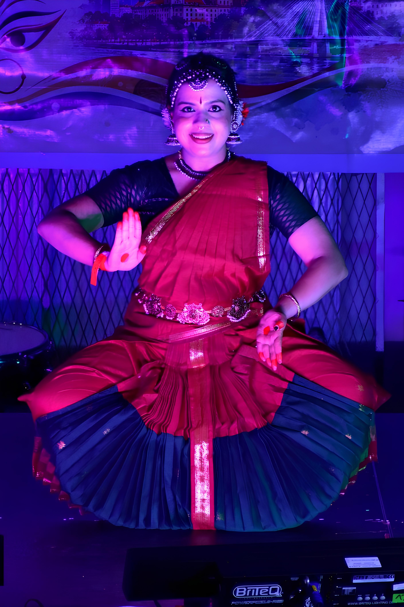

On 17 October 2026, <strong>Ranjana Mahesh</strong> presented a Bharatanatyam recital as part of the Durga Puja celebrations organised by the Warsaw Bengali Association of Poland at the CRS Bielany Sports Complex in Warsaw.

The performance featured the devotional composition <em>Sri Chakra Raja</em>, celebrating the divine feminine through expressive storytelling, graceful movements, and traditional Bharatanatyam artistry. The recital reflected the spirit of devotion and reverence associated with Durga Puja, honouring the divine feminine and the cultural richness of Indian classical dance.

    

